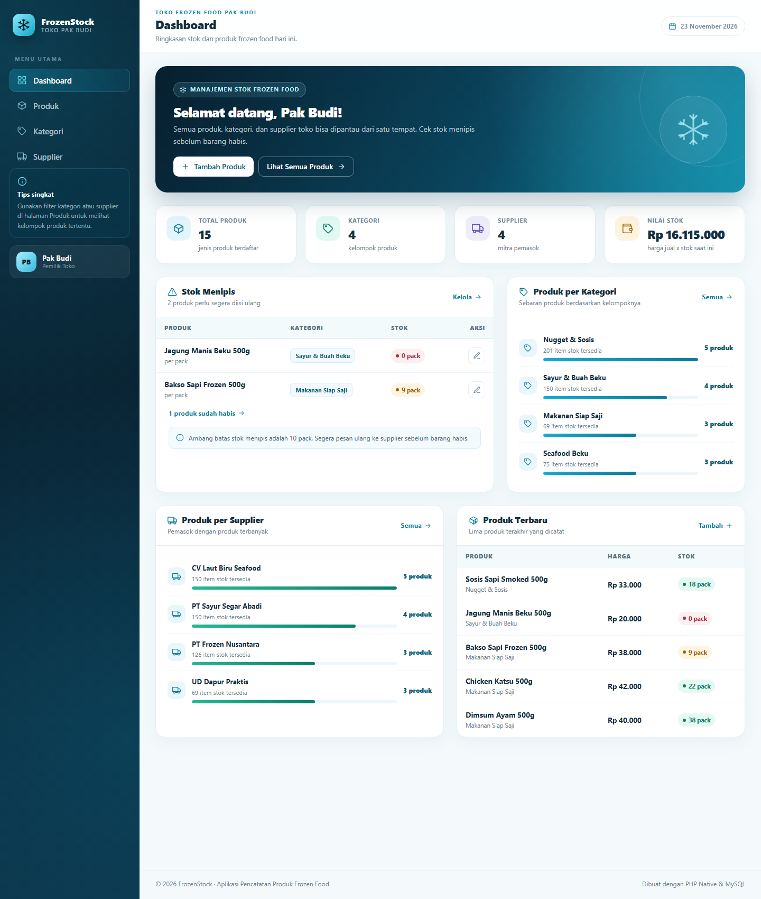
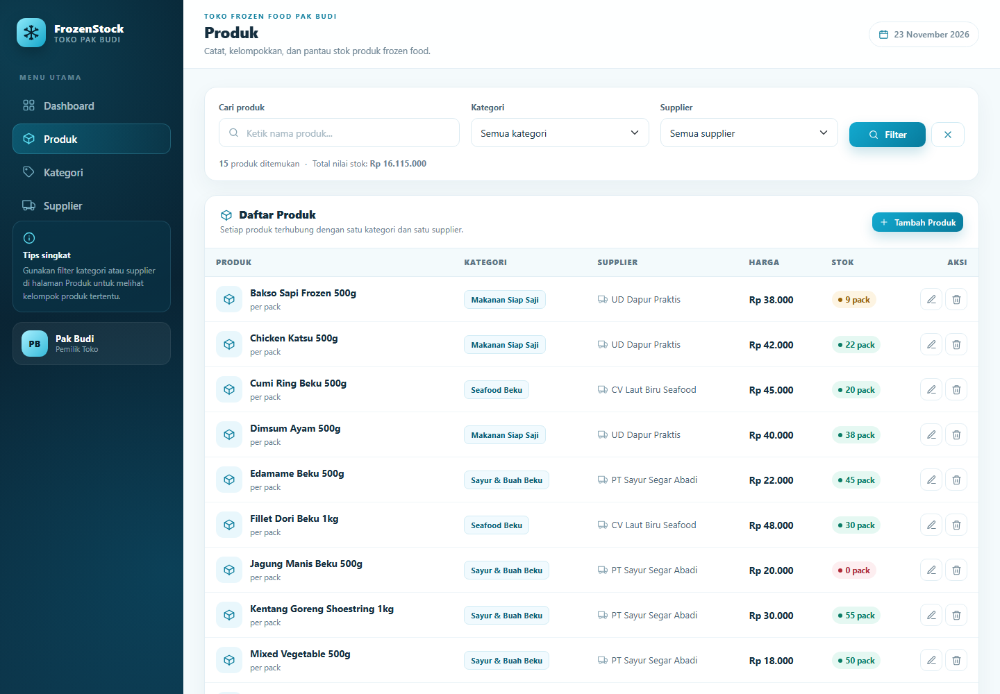
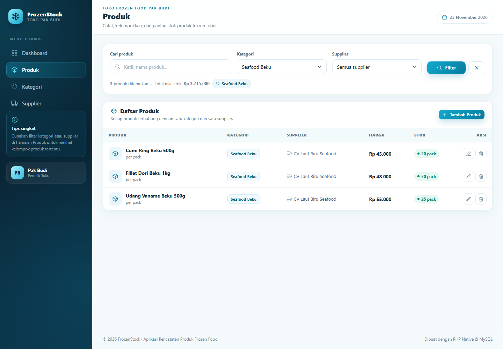
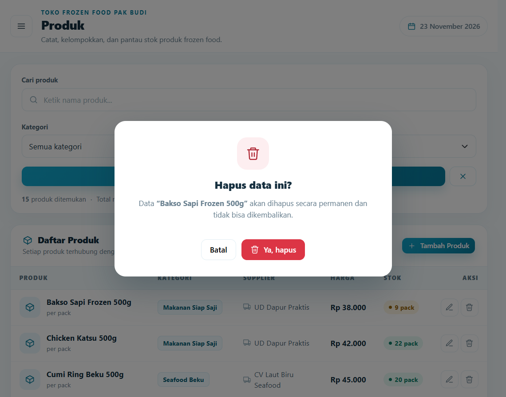
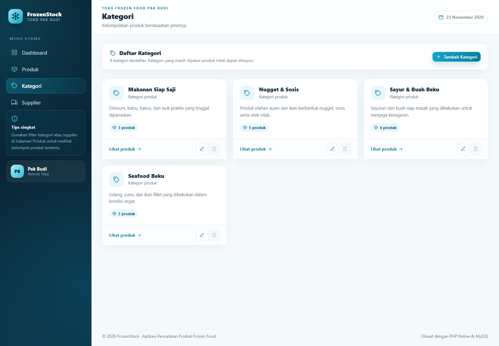
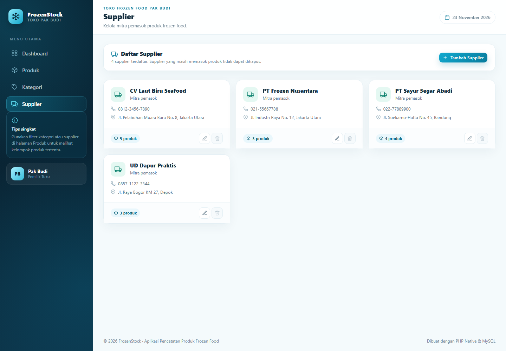
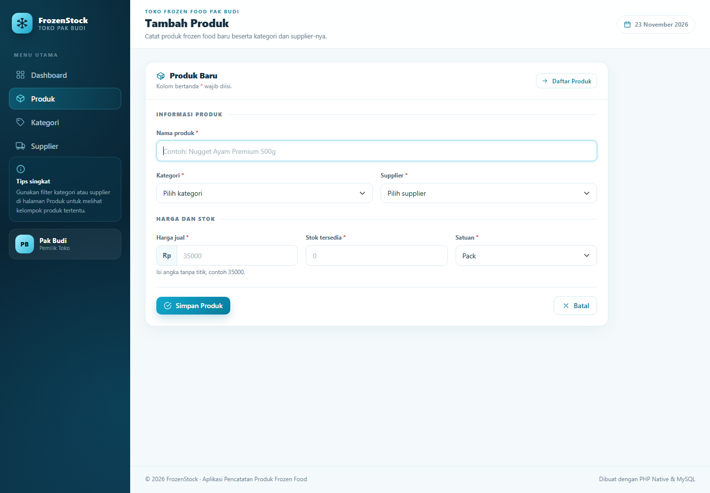
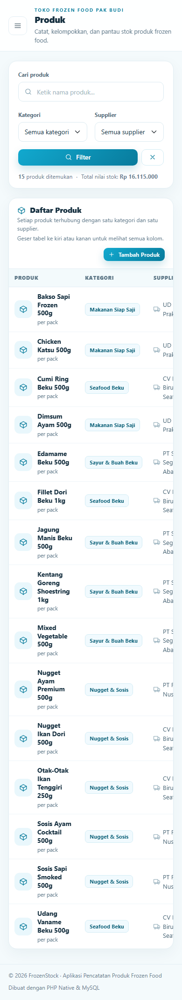

# FrozenStock — Aplikasi Pencatatan Produk Frozen Food

Aplikasi web untuk membantu **Pak Budi**, pemilik usaha frozen food, mencatat produk, mengelompokkan produk berdasarkan kategori, dan mencatat asal produk dari tiap supplier. Dibuat dengan **PHP Native** dan **MySQL/MariaDB** tanpa framework.



## Identitas

| Keterangan | Isi |
| ---------- | --- |
| **Nama** | Agha |
| **Kelas** | XI PPLG |
| **Repository** | <https://github.com/agha2528/frozen-food-pak-budi> |
| **Teknologi** | PHP Native, MySQL/MariaDB, Bootstrap 5, HTML, CSS, JavaScript |

## Fitur

- **Dashboard** berisi jumlah produk, kategori, supplier, nilai stok, daftar stok menipis, sebaran produk per kategori, dan sebaran produk per supplier.
- **CRUD Produk** — menambah, melihat, mengubah, dan menghapus produk (nama, kategori, supplier, harga, stok, satuan).
- **CRUD Kategori** — menambah, melihat, mengubah, dan menghapus kategori produk.
- **CRUD Supplier** — menambah, melihat, mengubah, dan menghapus supplier beserta kontak dan alamat.
- **Filter per kategori** — pilih kategori pada halaman Produk, atau klik tautan kategori untuk langsung melihat produknya.
- **Filter per supplier** — pilih supplier pada halaman Produk, atau klik tautan supplier untuk langsung melihat produknya.
- **Pencarian produk** berdasarkan nama, serta filter stok habis/menipis.
- **Validasi input** di server: kolom wajib tidak boleh kosong, harga dan stok harus berupa angka, nama produk/kategori/supplier tidak boleh duplikat.
- **Konfirmasi hapus** memakai modal Bootstrap sebelum data dihapus.
- **Proteksi data terpakai** — kategori atau supplier yang masih dipakai produk tidak dapat dihapus, baik dari tampilan maupun dari server (foreign key `ON DELETE RESTRICT`).
- **Pesan notifikasi** (berhasil/gagal) dan tampilan responsif untuk desktop maupun HP.

## Teknologi

| Bagian | Keterangan |
| ------ | ---------- |
| Bahasa | PHP 8.2 (PHP Native, tanpa framework) |
| Database | MySQL / MariaDB |
| Koneksi | PDO dengan *prepared statement* |
| Tampilan | HTML5, CSS3, JavaScript, Bootstrap 5.3 (disimpan lokal di `assets/vendor`) |
| Ikon | SVG inline (tanpa library ikon tambahan) |

## Struktur Folder

```text
frozen-food-pak-budi/
├── assets/
│   ├── css/style.css                 # Gaya tampilan aplikasi
│   ├── js/app.js                     # Modal konfirmasi hapus & notifikasi
│   └── vendor/bootstrap/             # Bootstrap 5.3 (lokal)
├── config/
│   └── koneksi.php                   # Konfigurasi koneksi database
├── database/
│   └── database.sql                  # Struktur tabel + data contoh
├── docs/                             # Screenshot untuk README
├── includes/
│   ├── footer.php                    # Penutup layout + modal hapus
│   ├── form-kategori.php             # Form kategori (tambah/edit)
│   ├── form-produk.php               # Form produk (tambah/edit)
│   ├── form-supplier.php             # Form supplier (tambah/edit)
│   ├── functions.php                 # Fungsi bantu, session, CSRF, validasi
│   └── header.php                    # Sidebar, topbar, notifikasi
├── index.php                         # Halaman utama (dashboard)
├── produk.php                        # Daftar produk + filter
├── produk-tambah.php                 # Tambah produk
├── produk-edit.php                   # Ubah produk
├── produk-hapus.php                  # Proses hapus produk
├── kategori.php                      # Daftar kategori
├── kategori-tambah.php               # Tambah kategori
├── kategori-edit.php                 # Ubah kategori
├── kategori-hapus.php                # Proses hapus kategori
├── supplier.php                      # Daftar supplier
├── supplier-tambah.php               # Tambah supplier
├── supplier-edit.php                 # Ubah supplier
├── supplier-hapus.php                # Proses hapus supplier
├── README.md
└── .gitignore
```

## Skema Database

Nama database: **`db_frozen_food`**

```text
kategori (1) ───< produk >─── (1) supplier
```

| Tabel | Kolom penting |
| ----- | ------------- |
| `kategori` | `id`, `nama` (unik), `deskripsi`, `created_at` |
| `supplier` | `id`, `nama` (unik), `kontak`, `alamat`, `created_at` |
| `produk` | `id`, `nama_produk` (unik), `kategori_id` (FK), `supplier_id` (FK), `harga`, `stok`, `satuan`, `created_at`, `updated_at` |

Relasi foreign key:

- `produk.kategori_id` → `kategori.id` (`ON UPDATE CASCADE`, `ON DELETE RESTRICT`)
- `produk.supplier_id` → `supplier.id` (`ON UPDATE CASCADE`, `ON DELETE RESTRICT`)

Data contoh yang disertakan: **4 kategori**, **4 supplier**, dan **15 produk** frozen food.

## Cara Menjalankan Aplikasi

### 1. Siapkan XAMPP

Install **XAMPP**, lalu jalankan **Apache** dan **MySQL** dari XAMPP Control Panel.

### 2. Letakkan folder proyek

Salin folder `frozen-food-pak-budi` ke dalam folder `htdocs` XAMPP:

```text
C:\xampp\htdocs\frozen-food-pak-budi
```

Atau clone repository:

```bash
cd C:\xampp\htdocs
git clone https://github.com/agha2528/frozen-food-pak-budi.git
```

### 3. Impor database

Buka <http://localhost/phpmyadmin>, pilih menu **Import**, lalu pilih file:

```text
database/database.sql
```

Klik **Go/Impor**. File tersebut otomatis membuat database `db_frozen_food`, ketiga tabel, relasi foreign key, dan data contoh.

Alternatif lewat terminal:

```bash
C:\xampp\mysql\bin\mysql.exe -u root < database/database.sql
```

### 4. Sesuaikan koneksi database (jika perlu)

Buka `config/koneksi.php`. Nilai bawaan XAMPP:

```php
define('DB_HOST', 'localhost');
define('DB_NAME', 'db_frozen_food');
define('DB_USER', 'root');
define('DB_PASS', '');
```

Jika MySQL menggunakan password, isi `DB_PASS` sesuai password masing-masing.

### 5. Buka aplikasi

Akses:

```text
http://localhost/frozen-food-pak-budi/index.php
```

Halaman utama wajib bernama `index.php`, dan seluruh halaman bisa dibuka melalui menu di sidebar.

## Alur Singkat Pemakaian

1. Buka **Kategori** untuk menambah kelompok produk (misalnya Nugget & Sosis).
2. Buka **Supplier** untuk mencatat mitra pemasok.
3. Buka **Produk → Tambah Produk** untuk mencatat produk baru.
4. Gunakan filter **Kategori** atau **Supplier** di halaman Produk untuk melihat kelompok produk tertentu.
5. Klik tombol pensil untuk mengubah data, atau tombol tempat sampah untuk menghapus (muncul konfirmasi terlebih dahulu).

## Catatan Teknis

- Semua query yang menerima input pengguna memakai **PDO prepared statement**.
- Formulir memakai **token CSRF**; proses hapus hanya menerima metode **POST**.
- Kategori/supplier yang masih memiliki produk ditolak saat dihapus, disertai pesan yang jelas (tidak menampilkan error PHP).
- Ambang batas **stok menipis** pada dashboard adalah **10**.
- Aplikasi tidak membutuhkan login; halaman utama langsung menampilkan dashboard pemilik toko.
- Tidak ada framework PHP atau library tampilan lain selain Bootstrap.

## Screenshot

### Daftar Produk dan Filter



### Filter Berdasarkan Kategori



### Konfirmasi Sebelum Menghapus



### Kategori



### Supplier



### Form Tambah Produk



### Tampilan HP



---

© 2026 FrozenStock — Proyek PHP Native & MySQL.
